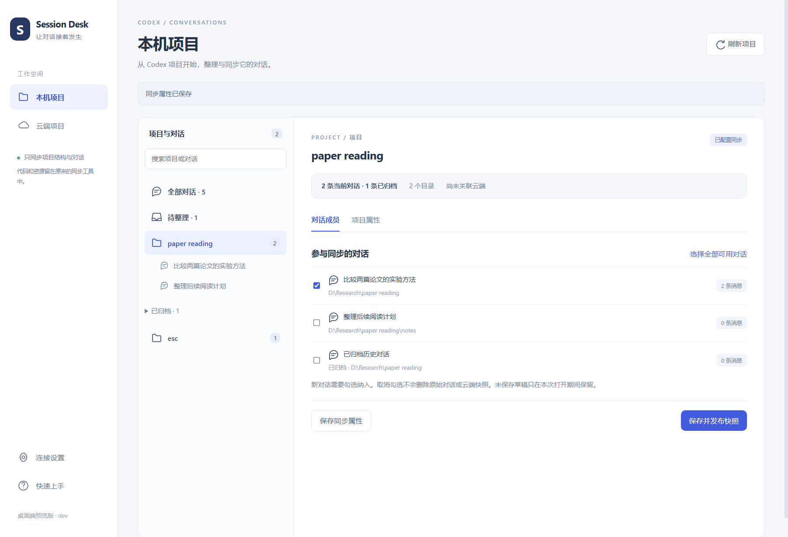

# Session Desk

面向 **Codex 桌面端**的本地会话管理与多设备同步工具。把项目与对话关联起来，通过自己的 WebDAV 或同步文件夹，在另一台电脑继续工作。

> 独立社区项目，与 OpenAI 无隶属关系。当前为 Windows x64 / macOS 预览版，原生项目接口仍可能随 Codex 版本变化。首次使用前请备份 Codex 数据。

[下载最新版 Windows / macOS](https://github.com/woufs-cs/codex-session-desk/releases/tag/v0.16.0-beta.5) · [报告问题](https://github.com/woufs-cs/codex-session-desk/issues)



## 能做什么

- 浏览本机 Codex 项目、当前对话和归档记录，查看可读取的消息。
- 显示全部对话与待整理对话；手动批量调整项目归属、修改名称。
- 修改归属前备份，通过 Codex 原生接口回读验证；可撤销最近一条归属调整。
- 按项目勾选参与同步的对话，发布包含项目结构的快照。
- 使用私人 WebDAV（如坚果云）或已经由同步工具同步的本地文件夹。
- 在不同机器上绑定同一云端项目、映射不同的工作目录。
- 接收前预览内容差异、目录和标题策略；同一 ID 保留一个版本，冲突逐条选择本机或云端。
- 默认按系统时区显示时间，可选择北京时间或 UTC；持久化时间仍使用 UTC。

**当前不提供项目代码／资源同步，不提供独立 CLI 会话接入流程，也不自动后台同步。** 项目文件请继续通过 Git、坚果云等工具准备。底层使用 Codex CLI 的 app-server 作为桌面元数据连接程序，不调用模型生成回答。

## 下载与启动

当前预览版 **0.16.0-beta.5**：支持新版 Codex 的 Zstandard 压缩原始历史与分页消息；接收后重建目标对话的派生分页索引，并通过原生分页接口验证，避免覆盖后仍显示旧消息。优先检测桌面端自带的新版连接程序。

- [Windows Setup 安装版](https://github.com/woufs-cs/codex-session-desk/releases/download/v0.16.0-beta.5/SessionDesk-0.16.0-beta.5-Setup-win-x64.exe)
- [Windows 单文件便携 EXE](https://github.com/woufs-cs/codex-session-desk/releases/download/v0.16.0-beta.5/SessionDesk-0.16.0-beta.5-portable-win-x64.exe)
- [Apple Silicon Mac DMG](https://github.com/woufs-cs/codex-session-desk/releases/download/v0.16.0-beta.5/SessionDesk-0.16.0-beta.5-mac-arm64.dmg)
- [Intel Mac DMG](https://github.com/woufs-cs/codex-session-desk/releases/download/v0.16.0-beta.5/SessionDesk-0.16.0-beta.5-mac-x64.dmg)
- [全部附件、校验文件及验收限制](https://github.com/woufs-cs/codex-session-desk/releases/tag/v0.16.0-beta.5)

Mac 安装：打开 DMG，把应用拖入 Applications。包未签名／公证，必要时在系统“隐私与安全性”中允许打开。应用自带运行环境，无需安装 Node.js；仍需检测本机 Codex 连接程序。

另一台电脑升级时，先退出 Session Desk，运行 Setup，沿用原来的安装目录和安装范围（当前用户／所有用户）。所有用户安装需要 Windows 管理员授权。覆盖升级保留该电脑的配置、同步库连接和项目绑定，无需先卸载。首次安装到另一台电脑时，仍需连接同一个同步库，并为云端项目选择该电脑的本地项目目录。建议两台电脑都更新后，再重新扫描和预览同步。

### Setup 安装版（推荐）

下载 **`SessionDesk-版本-Setup-win-x64.exe`**，运行安装向导，可选择 D 盘等安装位置。安装版会创建桌面和开始菜单快捷方式，并显示在 Windows“设置 → 应用 → 已安装的应用”中，可从那里卸载。默认仅为当前 Windows 用户安装，无需管理员权限。

安装版同样包含应用运行环境，但 **Codex 连接程序仍需单独准备**：在应用中先点击自动检测，未找到时安装 Codex CLI，再重新检测。

升级时先退出 Session Desk，再运行新版 Setup。卸载保留应用设置与备份，不会删除 Codex 对话。安装版与便携版共享当前用户的设置，不要同时运行两份。

### 单文件便携版

当前预览版同时提供 Setup 和单文件 portable EXE。

也可以从 [Releases](https://github.com/woufs-cs/codex-session-desk/releases/tag/v0.16.0-beta.5) 下载 **`SessionDesk-版本-portable-win-x64.exe`**：

1. 将这个 EXE 放到任意可写位置，例如 D 盘工具目录，双击即可启动。
2. 无需安装、无需手动解压，不需要把 DLL 或 resources 文件夹放在旁边。
3. 首次启动需要自动解压运行依赖，请等待应用窗口出现；使用临时目录，因此需留有足够磁盘空间。正常退出后清理本次运行的临时文件。
4. 在“连接设置”检测 Codex 连接程序；检测失败时手动选择 `codex.exe`。便携版包含应用运行环境，但不捆绑 Codex 连接程序。

原来的 ZIP 版继续保留：下载 `SessionDesk-版本-win-x64.zip` 后完整解压，运行文件夹里的 `SessionDesk.exe`。**ZIP 内的 EXE 不能单独复制使用**；文件名带 `portable` 的下载附件才是单文件版。

上述格式共享同一 Windows 用户下的应用设置。切换格式或更新时先退出旧版，不要同时运行两份。更新时下载新版 EXE 并替换旧文件即可；设置和对话不在 EXE 内，也不会跟随 EXE 自动复制到另一台机器。另一台机器仍需设置自己的连接与项目映射。

便携包包含 Electron，不需要自行安装 Node.js。发布包尚未代码签名。应用不提供账号服务；WebDAV 账号与 Codex 登录由你自己的服务管理。

需要本机安装支持 `project/*` 和 `thread/metadata/update` 实验接口的 Codex 连接程序。若提示接口不支持，请更新 Codex 连接程序；不要手工改 SQLite 来绕过验证。

## 第一次在两台机器上同步

### 1. 准备三个不同位置

| 位置 | 用途 | 示例 |
|---|---|---|
| 项目目录 | 代码、论文、资源 | `D:\Work\MyProject` |
| Codex 数据目录 | 本机对话历史与项目元数据 | `%USERPROFILE%\.codex` |
| 同步库 | 本应用发布的对话快照 | 私人 WebDAV 或同步文件夹 |

两台电脑的项目目录不必相同。应用的读取／接收位置应选择本机 Codex 数据目录，不是代码目录，也不要把两台机器的整个 `.codex` 用网盘互相覆盖。

### 2. 两边连接同一个同步库

**WebDAV：**填写同一个服务地址、账号及应用密码，测试并保存。坚果云可使用 `https://dav.jianguoyun.com/dav/`；也可以先创建专用子文件夹并填写对应完整地址。应用自动创建自己的 `SessionDesk` 内部目录。使用应用密码，不要把账号主密码写入项目。

**本地同步文件夹：**先让坚果云等工具将同一个云端文件夹同步到两边，再在应用中分别选择它们的本地位置。只有文件夹同名并不等于已经同步。

存储地图中的读取目录、接收目录、本地同步库都有文件夹选择入口。WebDAV 是网址，不能用本机文件夹选择器选择。设置、暂存和备份位置由应用管理。切换同步库不会迁移旧快照。

### 3. 第一台发布

1. 进入“本机项目”，核对项目和成员；未归类对话可在“待整理”中调整归属。
2. 勾选要上传的对话，归档对话按需选择；新对话不会自动加入。
3. 结束正在执行的任务，点击“保存并发布快照”。
4. 使用本地文件夹模式时，等待同步工具上传完成。

### 4. 另一台接收

1. 先准备好项目代码／资源；等待同步文件夹下载完成。
2. 打开“云端项目”，核对快照时间和来源设备，选择“接入并预览”。
3. 指定本机项目目录，并绑定已有 Codex 项目，或选择接收时新建。
4. 检查目录映射、对话差异和标题策略。
5. 完全退出 Codex，保持 Session Desk 打开，点击“接收并验证”。
6. 验证完成后再打开 Codex；未完成时查看最近接收记录并重试验证。

第二台应先接入已有云端项目，不要先发布一个同名但独立的云端项目。第一次发布的机器不是主机；两边之后都可发布和接收。

### 日常切换

**离开前发布 → 等待上传完成 → 另一台等待下载 → 接收并验证 → 继续对话。**

各设备快照独立保留，接收的是所选快照，不会自动汇总所有设备。即使不同时聊天，未接收最新版本就继续，也可能产生分叉。

## 对话身份、标题与冲突

- 云端项目 ID 代表同步身份；每台机器绑定自己的 Codex Project ID 和目录。
- 对话使用 Thread ID 识别，不靠标题识别。同一个 ID 可以在两台机器上有不同标题。
- 已有对话默认保留本机标题，新对话默认采用快照标题；预览中可选择。同步的是单独设置的标题，自动摘要不一定作为标题同步。
- 修改所属项目不改变工作目录；不删除或拼接消息。

| 差异 | 处理 |
|---|---|
| 新增 | 导入 |
| 远端为本机完整追加 | 更新同一对话，不创建永久历史副本 |
| 相同 | 跳过 |
| 本机更完整 | 保留本机 |
| 两边分叉 | 逐条选择保留本机或采用云端，保持原 ID |

冲突必须逐条确认。采用云端会替换本机完整历史，保留本机会维持现有历史；不自动合并或创建分叉。需要分叉时请在 Codex 中手动创建。项目归属冲突需先核对绑定。选择保留本机后，可发布本机项目，再让另一台接收该快照。

## 数据和隐私

- 应用设置与暂存位于 Electron 用户数据目录，准确位置可在“存储地图”查看。
- 接收不保存永久会话备份；仅保留 `session-desk-reports` 中不含正文的操作报告。临时回滚文件在成功或完成回滚后清理，回滚失败时保留供排查。已有备份、归属调整和单条目录修复记录不会自动删除。
- 上传的是完整会话记录，可能含工具输出、文件片段和凭据，**不自动脱敏，也不提供客户端端到端加密**。请使用你有权访问的私人存储。
- WebDAV 使用 HTTPS；保存的密码使用 Electron 系统安全存储加密，系统不支持时仅保留在本次运行内存中。
- 打包与源码发布排除真实对话、`.env`、本机设置、备份和测试产物。

## 从旧 CCT 脚本迁移

已导入 Codex 的对话可直接由应用读取，无需转换 `.codexbundle`。旧包不能直接作为本应用快照读取。

先备份两边数据，核对尚未导入的旧内容，再建立新的独立同步库。第一台发布，第二台接入并接收；第二台确认自己的独有对话也被勾选后发布，再由第一台接收。完成双向测试后停止运行旧脚本，保留旧包和导入记录供恢复。

## 从源码运行

建议 Windows、Node.js 24、npm 和 Git：

```powershell
npm ci
npm start
```

如果环境设置过 `ELECTRON_RUN_AS_NODE`，启动前清除它，或使用 `Start.cmd`。

```powershell
npm test
node scripts/test-project-native.cjs
powershell -NoProfile -ExecutionPolicy Bypass -File scripts/build-portable.ps1
npm run dist:portable
```

- `npm test`：本地合成数据测试，不需要 WebDAV 账号。
- 原生测试：需要可检测的 Codex 连接程序，在 `test-data` 中创建隔离环境，不使用真实对话或调用模型。
- `smoke-desktop.cjs`：Electron 界面流程测试，使用合成项目和模拟接口。
- `node scripts/test-single-exe.cjs`：启动真实单文件 EXE，在隔离设置目录验证界面、数据位置及退出后的临时运行文件清理，不使用真实对话。
- ZIP 打包：输出到 `dist`；同版本输出已存在时停止，防止覆盖历史包。
- 单文件打包：`npm run dist:portable` 先检查当前版本的已打包内容，再用 electron-builder / NSIS portable 生成 `dist/single-exe` 中的 EXE。仅封装白名单内的应用文件，拒绝不一致或含私有数据的输入。首次构建需要联网下载构建工具；用户运行成品无需下载 Electron。

### 代码入口

| 文件 | 职责 |
|---|---|
| `desktop.html` / `desktop-ui.js` / `desktop.css` | 当前桌面界面 |
| `main.cjs` / `preload.cjs` | Electron 和受限 IPC |
| `codex-rpc.cjs` / `desktop-membership.cjs` | 原生项目与历史关联识别 |
| `desktop-state.cjs` / `project-model.cjs` | 本机绑定、项目定义与目录映射 |
| `core.cjs` / `recovery.cjs` / `project-sync.cjs` | 快照传输、备份与恢复验证 |
| `time-format.js` | 时间解析、排序与时区显示 |

源码中保留部分早期 Git／项目文件同步模块用于兼容与回归测试，当前桌面界面未开放这些功能。

## 已知限制

- 当前只发布 Windows x64 包，其他平台未验证。
- 实验性 Codex 元数据接口可能变化；有些旧对话需手动整理归属。
- 暂不提供“彻底移出项目变为未归类”的按钮，避免旧桌面关联使它重新归回。
- 撤销仅针对最近一条归属调整，不是整个批次；重新勾选同步成员可能仍有必要。
- 时间显示遵从所选时区，但快照时间取决于发布机器的系统时钟。请保持系统时钟准确。
- 暂无自动更新或后台同步。

## 贡献与许可

欢迎通过 Issue 描述问题和通过 Pull Request 改进。请附版本、操作步骤和脱敏错误，不要上传真实 `.codex`、会话包、账号密码或含私密内容的截图。

采用 [MIT License](LICENSE)。Electron 等第三方组件使用各自许可证，随发布包保留。

### 构建安装版

运行 `npm run dist:setup`，生成 `dist/single-exe/SessionDesk-版本-Setup-win-x64.exe`。安装版与便携版共用经过白名单检查的应用文件，不包含本机账号、配置或对话。

### WebDAV 地址报错排查

服务地址必须是完整 HTTPS 网址。坚果云点击“使用坚果云地址”即可填入 `https://dav.jianguoyun.com/dav/`，再输入账号和应用密码。不要填写电脑上的文件夹路径、坚果云网页版网址或 Markdown 链接。空地址、无效格式以及查询参数会在连接前显示具体提示。

### 会话读取异常

发布、比较或恢复遇到会话读取失败时，会显示扫描目录、异常文件相对路径及原因（例如 JSON 行号、权限或超过 256 MB）。程序会对失败读取重试一次，但不会跳过损坏记录继续覆盖。请先退出 Codex，并确认按需同步文件已下载到本机后重试。仍失败时，将提示中的文件名与原因提供给维护者，不要直接删除原始对话。诊断不会显示消息正文。

### 大会话与项目折叠

单个会话及同步对象上限为 256 MB，本地扫描和云端读写使用同一上限。WebDAV 上传、下载允许最多 5 分钟；服务商自身的文件大小限制仍然有效。读取时逐条解析 JSONL，降低工具输出占用的额外内存。项目名称再次点击可收起，再点展开；收起不会清除右侧内容或未保存的勾选。

### 大文件内存控制（0.15.5）

扫描只保留有限预览，发布、下载、比较、备份和恢复通过文件流执行，不同时加载所有会话原文。单文件上限 256 MB。内嵌 Base64 图片（`data:image/...;base64,`）通过摘要与文件区间处理，单条记录的图片数据可超过 8 MB，恢复时分块复制原始图片，不截断或删除。除图片外的单条 JSONL 内容仍有 8 MB 安全解析上限；超限会停止并保留原文件。界面预览最多每条会话 64K 字符／200 条消息，整个扫描的预览预算 4M 字符；预览截断不影响完整同步。原生验证优先读取元数据，Codex 返回超大响应时停止验证并保留恢复报告。

测试与打包分开运行。`npm test` 使用串行测试和 192 MB JavaScript 堆上限，默认大文件样本为 1 MB。维护者可依次运行 `scripts/test-memory.ps1 -SizeMB 8`、`32`、`138`；每次仅一个进程、低优先级，384 MB 工作集或三分钟超限即停止，并要求至少 2 GB 空闲内存。只有前一级通过才运行下一级。打包采用较低压缩等级。上述限制不控制 Codex 本身或网盘客户端的内存。

## 0.15.5 接收流程改进

接收预览中，版本不同的对话需要逐条选择“保留本机版本”或“采用云端版本，替换本机”，可展开两边最后 6 条用户／助手消息；未选择或预览后本机内容变化会停止接收。路径分隔符差异和 JSON 字段顺序不会产生冲突，真实设置差异仍需选择。接收确认窗口可勾选自动关闭 Codex 桌面端、结束后重新打开；请先结束活动任务。不会强制结束进程，CLI 或无法正常关闭的窗口仍在运行时停止写入；原来未运行的应用不会被自动启动。

接收扫描、比较、准备与原子写入在独立工作线程串行执行，界面显示阶段和条目进度。预览／结果每次显示 50 条，对话使用本地文字徽标，避免图片与字体图标依赖。目录验证失败会分别保留“可读”和“目录匹配”状态，并显示预期目录和 Codex 实际目录。请先关闭 Codex 后使用“重试验证”；持续不一致时核对目录映射并保留报告，不要删除对话或反复覆盖。

若大对话元数据不可读，不会自动调用会返回完整历史的 resume；已接收文件和备份保留，需在 Codex 中检查发现情况后重试验证。

## 0.15.6：单条修复与扫描优化

- 云端 → 最近接收记录与单条修复：待处理对话显示预期目录和 Codex 实际目录，点击“修复这一条”并核对目录。只修复所选 ID；其他对话的内容和验证结果保持不变。若预期目录不正确，先返回接收预览修改映射。
- 修复前需退出 Codex，可勾选自动关闭／重新打开。正常退出失败后，会另行询问是否结束已识别的桌面端残留进程；不会自动结束独立 CLI。拒绝或未关闭完整时停止写入。
- 会话文件目录已正确、原生索引目录仍旧时，备份后定点修改 `state_5.sqlite` 的 `threads.cwd`，再启动新的 Codex 连接验证目录与项目归属。不删除索引、不修改其他行、不发送消息。仅支持已检查的数据库结构；文件身份、索引路径或旧目录变化会停止。
- 单条修复备份位于 `<Codex 数据目录>/session-desk-backups/repair-<唯一编号>/`，包含 `original.jsonl` 和 `repair.json`。报告保存修改前的索引目录。验证失败时尝试条件回滚；如回滚失败，保留报告供排查，不重复覆盖。
- 会话列表只读取元数据，打开对话时才加载有限文本预览；当前进程复用未变化文件的扫描结果（最多 5000 项，只缓存元数据），文件修改后重新读取。应用重启后首次仍需扫描。发布及写入前继续校验涉及文件的内容，缓存不代替写入校验。
- 新接收报告记录文件位置，接收后验证只检查报告中的会话；旧报告首次需要扫描补全位置。单条修复只重新读取所选文件。

升级后进入“云端 → 最近接收记录与单条修复”，核对预期目录，再点击待处理对话旁的“修复这一条”。若预期目录本身不正确，请先重新预览并修改映射。
## macOS 适配预览（0.16.0-beta.1）

[下载 macOS 源码启动包](https://github.com/woufs-cs/codex-session-desk/releases/download/v0.16.0-beta.1/SessionDesk-0.16.0-beta.1-mac-source.zip) · [预发布说明](https://github.com/woufs-cs/codex-session-desk/releases/tag/v0.16.0-beta.1)

新增 macOS 的 Codex CLI 检测、正常退出／重启与 Windows ↔ Mac 目录映射支持。可以在 Mac 安装 Node.js 24+ 后执行 `bash scripts/start-mac.sh` 启动完整界面，或运行 `npm run dist:mac` 在 Mac 上生成 DMG/ZIP。

这是尚未经过 Mac 真机验收的预览源码；上方 0.15.6 是已发布的 Windows 稳定版本。Mac 首版不强制终止进程，未签名的构建也可能受到系统打开限制。详细安装、同步、打包和测试步骤见 [macOS 使用指南](docs/macos.md)。

## 0.16.0-beta.5：桌面登记与单版本接收

下载：[Windows / macOS 安装包](https://github.com/woufs-cs/codex-session-desk/releases/tag/v0.16.0-beta.5)。Windows 选择 Setup EXE（安装版）或 portable EXE（便携版）；Apple Silicon 选择 mac-arm64.dmg，Intel Mac 选择 mac-x64.dmg，将应用拖入 Applications。Mac 包未签名或公证，系统可能要求在“隐私与安全性”中明确允许打开；不需要关闭系统安全功能。连接程序仍使用本机 Codex CLI，安装包不包含账号或用户配置。

接收冲突逐条选“保留本机”或“采用云端，替换本机”，同一 ID 仅保留当前版本，不再自动分叉、不保存永久对话备份。选择本机后，需发布本机快照，再由另一台接收。云端已有快照及本机历史分叉不会自动删除。

桌面项目登记与底层数据库归属分开验证。原生接收完成后，在 Codex 完全退出时，兼容已识别的 `.codex-global-state.json` 结构：按原生项目 ID 复用登记，补齐主机映射、会话关联及排序。不通过同名或同目录猜测合并项目。未知结构、其他主机归属、其他项目关联或文件并发修改会停止登记，并报告具体原因。

登记修复会保留一份桌面设置备份（`session-desk-backups/desktop-registration-*.json`），不是会话正文副本。该配置影响多个项目，因此保留恢复依据。底层验证通过不再宣称侧栏验收完成；登记成功后仍需重启 Codex 核对项目和对话。当前没有受支持的侧栏查询接口，因此 UI 明确保留“侧栏待确认”。

对于 beta.1 已接收但没有显示的项目：选择原来接收的目标项目 ID（不要重新创建同名项目），在接收结果中“重试验证”。如果仍保留接收报告，可直接重试；无需重复导入 14 个会话文件。登记成功后重新打开 Codex，检查项目成员，再测试新增一条对话的同步。若已有第二个同名项目，本版本不删除或合并它。

macOS `/tmp`、`/var`、`/etc` 仅在实际解析为对应 `/private/...` 系统目录时放行；其他符号链接仍拒绝。Mac IPC 测试补齐退出检查模拟。安装包构建与自动化测试不代替真实 Codex 桌面端侧栏验收。


## 性能与冲突查看（beta.4）

接收预览复用按 SHA-256 校验的已下载快照，缓存损坏会重新获取。目录映射后只比较一次，比较与快照解析在后台工作线程串行执行，避免阻塞界面。读取仍保留完整性校验，不以缓存代替接收前的变更检查。

冲突展开后并排显示两端最后 6 条用户／助手消息，附角色与时间，按时间顺序阅读，不展示开头摘要或工具日志。单条超长消息显示前 16K 字符并明确标注截断，图片显示数量，不加载大图片。重复查看使用有大小上限的缓存，文件变化后重新读取。首次读取大对话仍需要流式扫描；本版未声称具体倍数的加速。

### 分页历史兼容

扫描同时支持 `.jsonl` 和 `.jsonl.zst`，上传完整原始历史，而不是仅导出界面摘要。解压、映射与导出按流处理，解压后的单文件上限仍为 256 MB。接收更新的分页对话时，需退出 Codex；应用只重建目标对话的派生索引，其他对话不受影响。未知数据库结构会停止处理并报告原因。仅有分页数据库、没有完整原始文件时，仍提示历史不可用，不会将不完整记录作为完整对话上传。

建议两台机器都升级，并在连接设置中重新自动检测 Codex 连接程序。Windows 原生分页读取、追加、覆盖和实际 EXE 启动已做隔离验证；Mac 安装包经 CI 构建与自动测试，真实桌面侧栏显示仍需真机验收。
